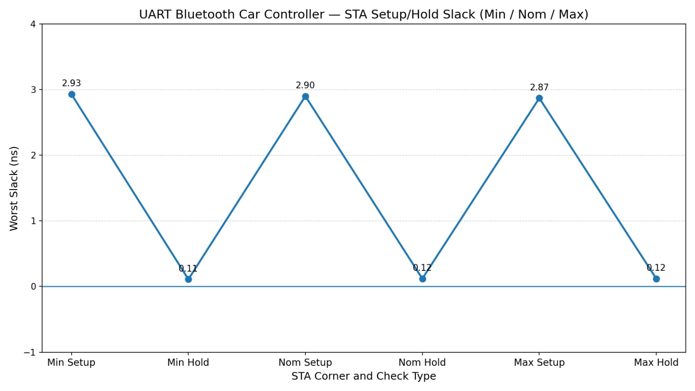

# UART Bluetooth Car Controller
### From Verilog RTL to GDSII on the open-source OpenLane + SkyWater Sky130 flow

> A Bluetooth-controlled car brain, designed in Verilog and taken all the way to a manufacturable chip layout, with timing signed off across every process corner.

---

## Table of Contents

1. [Introduction](#introduction)
2. [Key Highlights](#key-highlights)
3. [How It Works](#how-it-works)
4. [Design Flow](#design-flow)
5. [Verification](#verification)
6. [Physical Design Results](#physical-design-results)
7. [Static Timing Analysis](#static-timing-analysis)
8. [Engineering Challenge: Fixing the Fanout Violation](#engineering-challenge-fixing-the-fanout-violation)
9. [Clocking](#clocking)
10. [Signoff](#signoff)
11. [Tools](#tools)
12. [What I Learned](#what-i-learned)
13. [Conclusion](#conclusion)

---

## Introduction

Wireless-controlled cars are a classic embedded project, but they usually run on a microcontroller. This project takes a different path: the control logic itself is built as a **custom digital chip design**.

A Bluetooth module sends commands to the car as a serial UART stream. The design receives that stream, decodes each command, and drives the motor control outputs that steer the car. Everything is written in Verilog and implemented as a clocked, sequential circuit.

The design was then pushed through a **complete RTL-to-GDSII flow** using OpenLane v1.0.2 and the open-source Sky130 process: synthesis, floorplanning, placement, clock tree synthesis, routing, multi-corner timing analysis and physical signoff. The result is a layout file that is ready for fabrication.

---

## Key Highlights

| | |
|---|---|
| **Design type** | Clocked sequential digital design (Verilog) |
| **Technology** | SkyWater Sky130, `sky130_fd_sc_hd` standard cells |
| **Flow** | OpenLane v1.0.2, RTL to GDSII |
| **Clock period** | 10 ns |
| **Timing** | TNS 0.00, WNS 0.00, positive setup and hold slack in all corners |
| **Corners analysed** | FF, TT and SS, each with min, max and nom RC extraction (9 combinations) |
| **Violations** | 0 max fanout, 0 max slew, 0 max cap |

---

## How It Works

```
 Bluetooth      +-----------+      +------------------+      +----------------+
  module   ---> |  UART RX  | ---> |  Car controller  | ---> | Motor outputs  |
 (serial data)  |  receiver |      | (command decode) |      | (left / right) |
                +-----------+      +------------------+      +----------------+
                        ^                    ^
                        |                    |
                      clk, reset  (shared clock and reset)
```

- **UART receiver** samples the incoming serial line and rebuilds each data byte.
- **Car controller** decodes the received byte into a movement command.
- **Motor outputs** drive the car's left and right motor control pins.
- **Top module** (`uart_bt_car_top`) connects everything to one clock and one reset.

---

## Design Flow

```
Verilog RTL
    |
RTL Simulation
    |
Synthesis
    |
Floorplanning  ->  IO Placement  ->  Power Planning
    |
Placement
    |
Clock Tree Synthesis (CTS)
    |
Routing
    |
Static Timing Analysis (multi-corner)
    |
DRC / LVS
    |
GDSII
```

---

## Verification

The design was verified with a Verilog testbench in RTL simulation, and the waveforms were inspected in GTKWave. The simulation confirms that serial input data is received correctly and that the motor outputs respond as expected.

---

## Physical Design Results

Final run: **fix3**

| Metric | Result |
|---|---|
| Standard cells | [FILL] |
| Total cell area | [FILL] |
| TNS | 0.00 |
| WNS | 0.00 |
| Worst setup slack | 2.80 ns |
| Worst hold slack | 0.10 ns |
| Total power (typical corner) | 6.86 x 10^-4 W |
| Internal power | 4.62 x 10^-4 W |
| Switching power | 2.24 x 10^-4 W |
| Leakage power | 2.14 x 10^-7 W |
| Max slew / fanout / cap violations | 0 / 0 / 0 |

---

## Static Timing Analysis

Timing was checked at the **Fastest (FF)**, **Typical (TT)** and **Slowest (SS)** corners, each under three RC extractions (**min**, **nom**, **max**). Every combination passes.

| RC extraction | Worst setup slack (ns) | Worst hold slack (ns) | TNS | WNS |
|---|---|---|---|---|
| min | 2.86 | 0.10 | 0.00 | 0.00 |
| nom | 2.83 | 0.11 | 0.00 | 0.00 |
| max | 2.80 | 0.11 | 0.00 | 0.00 |

**Worst setup slack per library corner:**

| Corner | min RC | nom RC | max RC |
|---|---|---|---|
| FF (Fastest) | 7.09 | 7.08 | 7.07 |
| TT (Typical) | 6.65 | 6.63 | 6.62 |
| SS (Slowest) | 2.86 | 2.83 | 2.80 |

The slowest corner (SS) is the tightest, as expected, and it still has about 2.8 ns of margin on a 10 ns clock. All slack values are above zero, so there are no timing violations. The negative-slack check reports `No paths found`, which is the result you want.



---

## Engineering Challenge: Fixing the Fanout Violation

An early run flagged a **max fanout violation** in every corner:

```
clkbuf_2_2__f_clk/X    limit 10    fanout 14    slack -4 (VIOLATED)
```

**Diagnosis.** The violation was on a clock-tree leaf buffer (`clkbuf_16`), not on a data path. Setup, hold, slew and capacitance were all already clean.

**What did not work.** Reducing the CTS sink clustering size did not change the result, because the clock tree was still built with the same two-level structure.

**What worked.** Setting the max fanout constraint to 16, which fits what a `clkbuf_16` clock buffer can drive:

```json
"MAX_FANOUT_CONSTRAINT": 16
```

**Result.** After re-running the flow, the max fanout violation count is **0** in all signoff reports.

| | Before | After |
|---|---|---|
| Max fanout violations | 1 | **0** |
| Max slew violations | 0 | 0 |
| Max cap violations | 0 | 0 |

---

## Clocking

- A single clock, `clk`, drives all sequential logic.
- CTS builds a two-level clock tree from `clkbuf_16` buffers.
- CTS settings: sink clustering size 5, maximum cluster diameter 30.
- Both setup and hold timing are analysed and met.

---

## Signoff

| Check | Result |
|---|---|
| Timing (setup and hold) | Pass in all FF, TT, SS corners and all RC extractions |
| Max slew / fanout / cap | 0 violations |
| DRC | [FILL] |
| LVS | [FILL] |
| XOR | [FILL] |
| GDSII | [FILL] |

---

## Tools

Verilog HDL, OpenLane v1.0.2, SkyWater Sky130 PDK (`sky130_fd_sc_hd`), GTKWave, KLayout, Ubuntu Linux

---

## What I Learned

- Designing a sequential system in Verilog: a UART receiver and a control block
- Verifying RTL with a testbench and reading waveforms
- Every stage of physical design, from synthesis to GDSII
- How clock tree synthesis shapes fanout, skew and timing
- Reading multi-corner STA reports: setup, hold, recovery, slew, cap and fanout
- Diagnosing a real violation, testing a fix that failed, and finding one that works

---

## Conclusion

The UART Bluetooth car controller went from Verilog RTL to a GDSII layout using a fully open-source flow. After fixing a max fanout violation on the clock tree, the final run has **zero fanout, slew and capacitance violations**, **TNS and WNS of 0.00**, and **positive setup and hold slack in every FF, TT and SS corner across min, nom and max RC extraction**.

The project is a complete example of taking a wireless-control design from idea to chip layout.
